## operaciones basicas con opencv
## Alumno Daniel Gallegos 1392
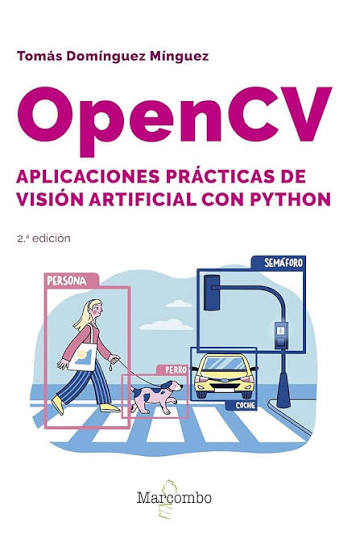
## 1. LECTURA DE LA IMAGEN
## cuando no puede cargar la imagen
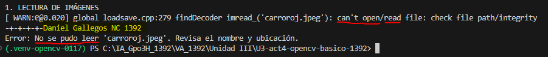
## cuando si puede cargar la imagen
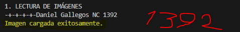
## Propiedades de la imagen
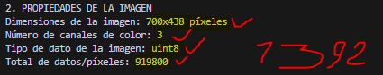
## 
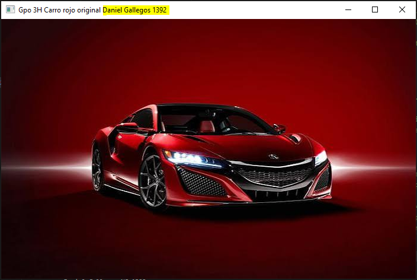
## En la terminal
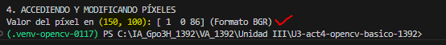
## Accedso y modificacion de pixeles
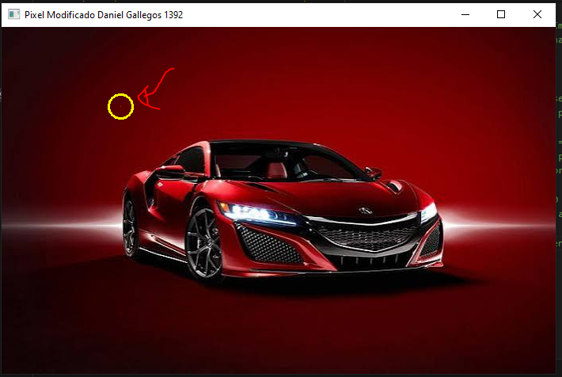
## Region de interes
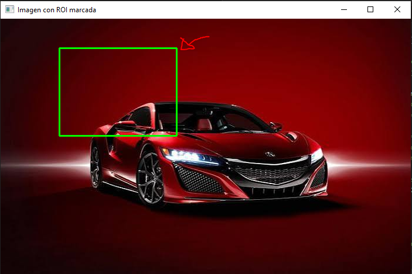
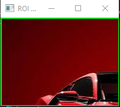
## Separacion y fusion de canales de color (BGR)
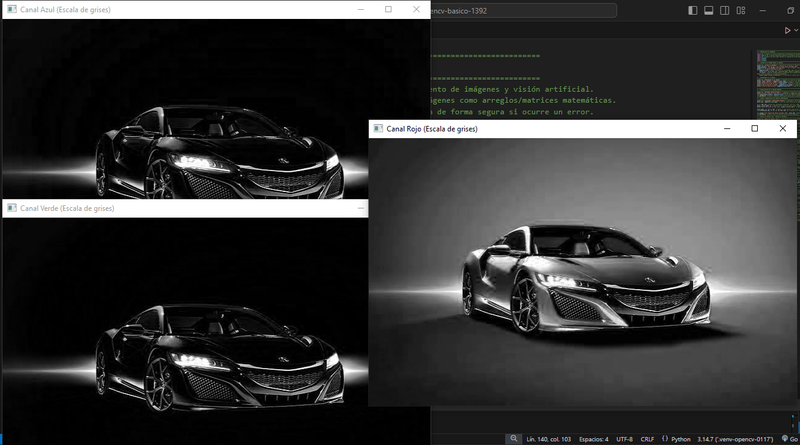
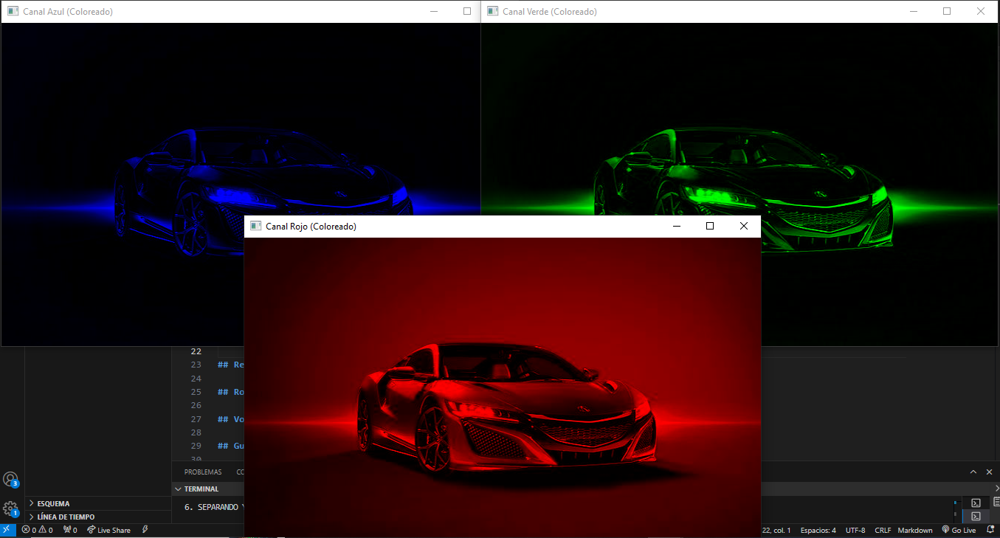
## Redimensionamiento de imagenes
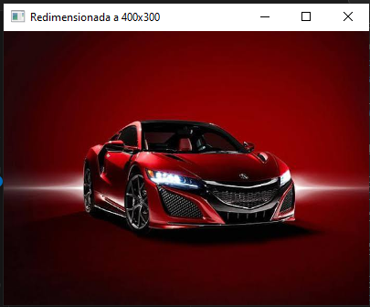
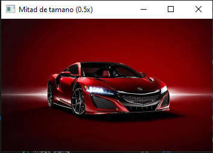
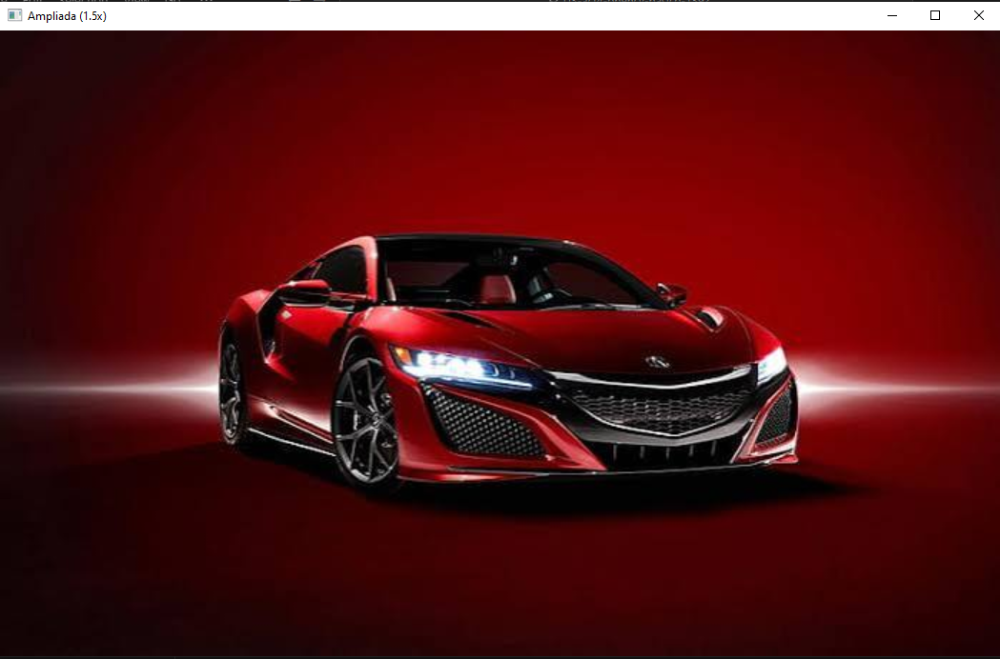
## Rotacion de imagenes
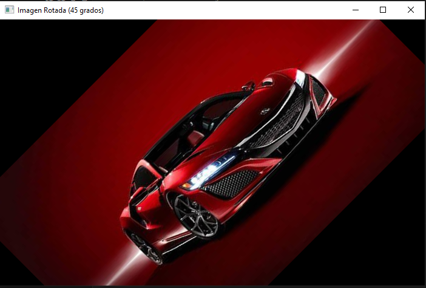
## Volteo/Espejo de imagenes
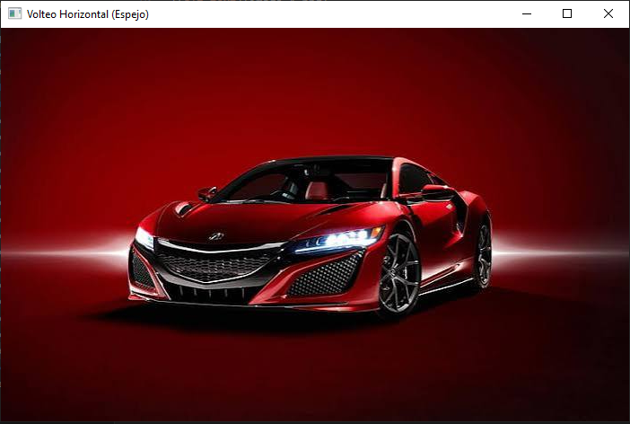
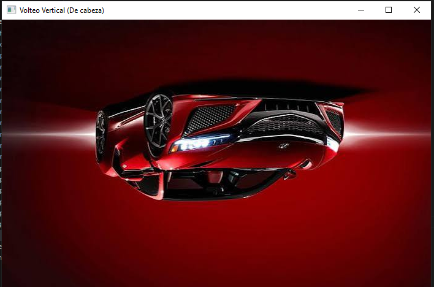
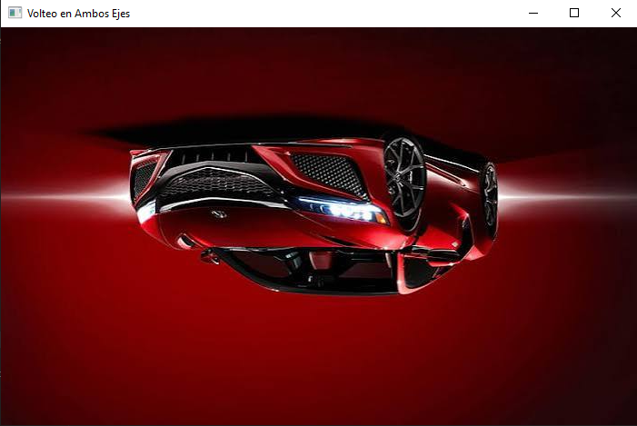
## Guardado de resultados y limpieza
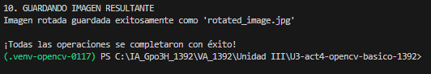